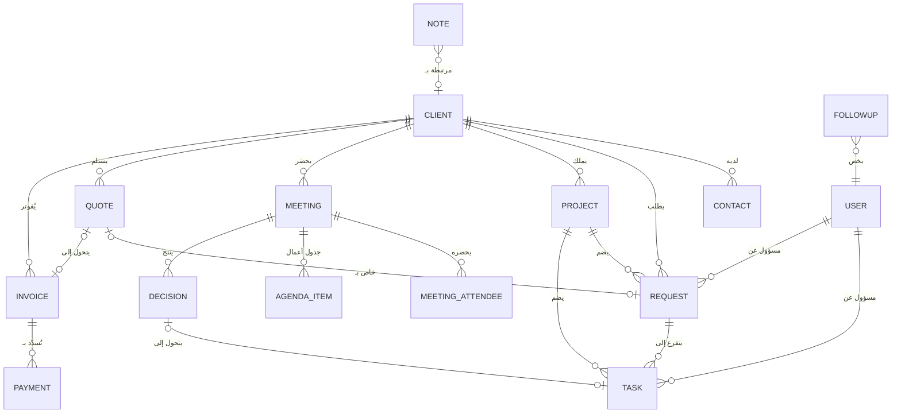

# نموذج البيانات (Data Model)

يصف هذا الملف الكيانات الأساسية في تطبيق المساعد الشخصي، وحقول كل كيان، والعلاقات بينها. هو المرجع لبناء قاعدة البيانات والواجهات البرمجية (API).

**اصطلاحات عامة**
- كل كيان يحتوي الحقول المشتركة: `id` (UUID)، `created_at`، `updated_at`، `created_by` (← المستخدم)، `deleted_at` (للحذف المؤقت).
- ✱ = حقل إلزامي.
- التواريخ تُخزَّن بتوقيت UTC، وتُعرض بتوقيت المستخدم (الافتراضي: Asia/Riyadh).
- المبالغ تُخزَّن كأرقام عشرية مع حقل العملة (الافتراضي: SAR).

---

## مخطط العلاقات

العناصر العامة (المتابعات، الملاحظات، المرفقات، سجل النشاط) ترتبط بأي كيان عبر الحقلين `related_type` و`related_id`.

---

## ١. المستخدم (User)

| الحقل | النوع | الوصف |
|------|------|-------|
| name ✱ | نص | الاسم الكامل |
| email ✱ | نص (فريد) | البريد الإلكتروني |
| phone | نص | رقم الجوال |
| role ✱ | قائمة | `owner` مالك · `manager` مدير · `employee` موظف |
| job_title | نص | المسمى الوظيفي |
| avatar_url | رابط | الصورة الشخصية |
| timezone | نص | الافتراضي `Asia/Riyadh` |
| is_active | منطقي | الحساب مفعّل |

## ٢. العميل (Client)

| الحقل | النوع | الوصف |
|------|------|-------|
| name ✱ | نص | اسم الشركة أو الجهة |
| type ✱ | قائمة | `company` شركة · `government` جهة حكومية · `individual` فرد |
| status ✱ | قائمة | `lead` محتمل · `active` نشط · `inactive` متوقف |
| sector | نص | القطاع |
| cr_number | نص | رقم السجل التجاري |
| vat_number | نص | الرقم الضريبي |
| city | نص | المدينة |
| address | نص | العنوان |
| source | قائمة | مصدر العميل: إحالة، موقع، معرض، تواصل مباشر، أخرى |
| account_manager_id | ← المستخدم | المسؤول عن العلاقة |
| tags | قائمة نصوص | وسوم للتصنيف |

**حقول محسوبة (للعرض في ملف العميل):** عدد الطلبات المفتوحة، إجمالي قيمة العقود، المبلغ المستحق، تاريخ آخر تواصل.

## ٣. جهة التواصل (Contact)

| الحقل | النوع | الوصف |
|------|------|-------|
| client_id ✱ | ← العميل | |
| name ✱ | نص | الاسم |
| position | نص | المنصب |
| phone | نص | الجوال |
| email | نص | البريد |
| is_primary | منطقي | جهة التواصل الرئيسية |

## ٤. الطلب (Request)

| الحقل | النوع | الوصف |
|------|------|-------|
| number ✱ | رقم تسلسلي | يظهر بالشكل #1042 |
| title ✱ | نص | عنوان الطلب |
| description | نص طويل | التفاصيل |
| client_id ✱ | ← العميل | |
| contact_id | ← جهة التواصل | مقدّم الطلب |
| project_id | ← المشروع | إن كان جزءًا من مشروع |
| service_type | قائمة | نوع الخدمة (تُعرَّف في الإعدادات) |
| status ✱ | قائمة | `new` جديد · `in_progress` قيد التنفيذ · `waiting_client` بانتظار العميل · `on_hold` معلّق · `closed` مغلق · `cancelled` ملغى |
| priority ✱ | قائمة | `low` منخفضة · `medium` متوسطة · `high` عالية · `urgent` عاجلة |
| assignee_id | ← المستخدم | المسؤول |
| received_at ✱ | تاريخ ووقت | تاريخ الاستلام |
| due_date | تاريخ | الموعد النهائي |
| closed_at | تاريخ ووقت | تاريخ الإغلاق |
| progress | رقم ٠–١٠٠ | نسبة الإنجاز (يدوي، أو محسوب من المهام) |
| estimated_value | مبلغ | القيمة التقديرية |
| channel | قائمة | قناة الاستلام: بريد، اتصال، واتساب، اجتماع، موقع |

**قواعد:**
- يُعتبر الطلب **متأخرًا** إذا تجاوز `due_date` وحالته ليست `closed` أو `cancelled`.
- عند تغيير الحالة إلى `waiting_client` تُنشأ متابعة تلقائية من نوع «أنتظرها».

## ٥. المهمة (Task)

| الحقل | النوع | الوصف |
|------|------|-------|
| title ✱ | نص | عنوان المهمة |
| description | نص طويل | التفاصيل |
| status ✱ | قائمة | `todo` جديدة · `in_progress` قيد التنفيذ · `done` منجزة |
| priority ✱ | قائمة | نفس قائمة الطلب |
| assignee_id ✱ | ← المستخدم | المنفّذ |
| assigned_by_id | ← المستخدم | من أسند المهمة (يميّز «مهامي» عن «المُسندة للفريق») |
| due_at | تاريخ ووقت | الموعد |
| completed_at | تاريخ ووقت | وقت الإنجاز |
| request_id | ← الطلب | |
| project_id | ← المشروع | |
| client_id | ← العميل | |
| source_decision_id | ← القرار | إن نشأت من قرار اجتماع |
| reminder_at | تاريخ ووقت | وقت التذكير |
| recurrence | نص | قاعدة التكرار (يومي، أسبوعي…) |

**مجموعات العرض في تبويب المهام:** متأخرة (`due_at` < الآن وغير منجزة) · اليوم · هذا الأسبوع · لاحقًا.

## ٦. الاجتماع (Meeting)

| الحقل | النوع | الوصف |
|------|------|-------|
| title ✱ | نص | عنوان الاجتماع |
| start_at ✱ | تاريخ ووقت | البداية |
| end_at ✱ | تاريخ ووقت | النهاية |
| type ✱ | قائمة | `in_person` حضوري · `online` عن بُعد · `call` مكالمة |
| location | نص | المكان |
| meeting_url | رابط | رابط الاجتماع عن بُعد |
| client_id | ← العميل | |
| request_id | ← الطلب | |
| project_id | ← المشروع | |
| status ✱ | قائمة | `scheduled` مجدول · `done` منعقد · `cancelled` ملغى · `postponed` مؤجل |
| minutes | نص طويل | المحضر |
| external_calendar_id | نص | معرّف الحدث في التقويم المربوط |

### بند جدول الأعمال (Agenda Item)
| الحقل | النوع | الوصف |
|------|------|-------|
| meeting_id ✱ | ← الاجتماع | |
| order ✱ | رقم | الترتيب |
| title ✱ | نص | البند |
| notes | نص | ملاحظات البند |

### الحاضر (Meeting Attendee)
| الحقل | النوع | الوصف |
|------|------|-------|
| meeting_id ✱ | ← الاجتماع | |
| user_id | ← المستخدم | حاضر من الفريق |
| contact_id | ← جهة التواصل | حاضر من العميل |
| attendance | قائمة | `invited` مدعو · `confirmed` مؤكد · `attended` حضر · `absent` غائب |

### القرار (Decision)
| الحقل | النوع | الوصف |
|------|------|-------|
| meeting_id ✱ | ← الاجتماع | |
| text ✱ | نص | نص القرار |
| owner_id | ← المستخدم | المسؤول عن تنفيذه |
| due_date | تاريخ | |
| task_id | ← المهمة | تُملأ عند «تحويل القرار لمهمة» |

## ٧. المشروع (Project)

| الحقل | النوع | الوصف |
|------|------|-------|
| name ✱ | نص | اسم المشروع |
| client_id ✱ | ← العميل | |
| manager_id | ← المستخدم | مدير المشروع |
| status ✱ | قائمة | `planning` تخطيط · `active` جارٍ · `on_hold` معلّق · `completed` مكتمل · `cancelled` ملغى |
| start_date | تاريخ | |
| end_date | تاريخ | |
| contract_value | مبلغ | قيمة العقد |
| progress | رقم ٠–١٠٠ | محسوب من المهام والمراحل |

### المرحلة (Milestone)
| الحقل | النوع | الوصف |
|------|------|-------|
| project_id ✱ | ← المشروع | |
| title ✱ | نص | |
| due_date | تاريخ | |
| is_done | منطقي | |

## ٨. المتابعة (Follow-up)

| الحقل | النوع | الوصف |
|------|------|-------|
| title ✱ | نص | ما المطلوب |
| direction ✱ | قائمة | `promised` وعدتُ بها · `waiting` أنتظرها من غيري |
| owner_id ✱ | ← المستخدم | صاحب المتابعة |
| counterpart | نص | الطرف الآخر (اسم أو جهة) |
| due_at ✱ | تاريخ ووقت | موعد المتابعة |
| status ✱ | قائمة | `open` مفتوحة · `done` تمت · `snoozed` مؤجلة |
| snoozed_until | تاريخ ووقت | |
| related_type / related_id | مرجع عام | عميل، طلب، اجتماع، عرض سعر… |
| source | قائمة | `manual` يدوي · `meeting` من اجتماع · `auto` تلقائي |

**تبويب «عروض أسعار» في شاشة المتابعات** يُعرض من جدول عروض الأسعار مباشرة (العروض المرسلة وبلا رد).

## ٩. المالية المختصرة

### عرض السعر (Quote)
| الحقل | النوع | الوصف |
|------|------|-------|
| number ✱ | نص | رقم العرض |
| client_id ✱ | ← العميل | |
| request_id | ← الطلب | |
| amount ✱ | مبلغ | قبل الضريبة |
| vat_amount | مبلغ | الضريبة |
| currency | نص | الافتراضي SAR |
| status ✱ | قائمة | `draft` مسودة · `sent` مُرسل · `accepted` مقبول · `rejected` مرفوض · `expired` منتهٍ |
| sent_at | تاريخ | |
| valid_until | تاريخ | |
| file_url | رابط | ملف العرض |

### الفاتورة (Invoice)
| الحقل | النوع | الوصف |
|------|------|-------|
| number ✱ | نص | رقم الفاتورة |
| client_id ✱ | ← العميل | |
| project_id / quote_id | مرجع | |
| total ✱ | مبلغ | الإجمالي شامل الضريبة |
| issue_date ✱ | تاريخ | |
| due_date ✱ | تاريخ | تاريخ الاستحقاق |
| status ✱ | قائمة | `issued` صادرة · `partially_paid` مدفوعة جزئيًا · `paid` مدفوعة · `overdue` متأخرة · `void` ملغاة |

### الدفعة (Payment)
| الحقل | النوع | الوصف |
|------|------|-------|
| invoice_id ✱ | ← الفاتورة | |
| amount ✱ | مبلغ | |
| paid_at ✱ | تاريخ | |
| method | قائمة | تحويل بنكي، نقدًا، شيك، أخرى |

> هذه مالية **مختصرة** للمتابعة فقط. الفوترة الإلكترونية الرسمية (فاتورة) تبقى في نظام المحاسبة، ويمكن ربطه لاحقًا.

## ١٠. الملاحظة (Note)

| الحقل | النوع | الوصف |
|------|------|-------|
| content ✱ | نص طويل | المحتوى |
| type | قائمة | `idea` فكرة · `call` مكالمة · `general` عامة |
| is_pinned | منطقي | مثبتة |
| related_type / related_id | مرجع عام | |
| converted_task_id | ← المهمة | عند تحويلها لمهمة |

## ١١. كيانات مساندة

### المرفق (Attachment)
`file_name` ✱ · `file_url` ✱ · `mime_type` · `size` · `related_type / related_id` ✱

### الإشعار (Notification)
| الحقل | النوع | الوصف |
|------|------|-------|
| user_id ✱ | ← المستخدم | المستلم |
| type ✱ | قائمة | `meeting_soon` اجتماع قريب · `task_due` مهمة مستحقة · `request_overdue` طلب متأخر · `followup_due` متابعة مستحقة · `assigned` إسناد جديد · `quote_no_reply` عرض بلا رد |
| title ✱ | نص | |
| related_type / related_id | مرجع عام | الضغط على الإشعار يفتح العنصر |
| read_at | تاريخ ووقت | |
| send_at ✱ | تاريخ ووقت | |

### سجل النشاط (Activity Log)
يُكتب تلقائيًا ويُعرض في «السجل» داخل ملف العميل:
`actor_id` · `action` (أنشأ، عدّل الحالة، أسند، علّق…) · `related_type / related_id` · `changes` (JSON) · `client_id` (لتجميع سجل العميل).

---

## الصلاحيات المبدئية

| الصلاحية | المالك | المدير | الموظف |
|----------|:-----:|:-----:|:-----:|
| رؤية كل الطلبات والمهام | ✓ | ✓ | المسندة إليه فقط |
| إسناد المهام والطلبات | ✓ | ✓ | — |
| العملاء (عرض) | ✓ | ✓ | ✓ |
| العملاء (تعديل) | ✓ | ✓ | — |
| المالية | ✓ | — | — |
| التقارير | ✓ | ✓ | — |
| الإعدادات والمستخدمين | ✓ | — | — |

## التنبيهات التلقائية المقترحة

| الحدث | التوقيت |
|------|--------|
| اجتماع قريب | قبل ٣٠ دقيقة |
| مهمة مستحقة | وقت `reminder_at`، أو صباح يوم الاستحقاق |
| طلب متأخر | يوميًا ٩:٠٠ ص حتى يُغلق |
| متابعة مستحقة | وقت `due_at` |
| عرض سعر بلا رد | بعد ٣ أيام من الإرسال |
| فاتورة متأخرة | يوم الاستحقاق، ثم أسبوعيًا |

## ربط الشاشات بالبيانات

| الشاشة | مصدر البيانات |
|-------|--------------|
| لوحة اليوم | اجتماعات اليوم · مهام اليوم والمتأخرة · طلبات متأخرة · متابعات مستحقة |
| الطلبات | Request مع فلترة حسب `status` |
| المهام | Task مع التقسيم حسب `assignee_id` و`assigned_by_id` |
| الاجتماعات | Meeting + Agenda Item + Attendee + Decision |
| ملف العميل | Client + Contact + الحقول المحسوبة + Activity Log |
| المتابعات | Follow-up حسب `direction` + Quote بحالة `sent` |
| إضافة سريعة | إنشاء Task / Request / Meeting / Follow-up / Note |
| المزيد | Project · Invoice · Note · التقارير المجمّعة |
